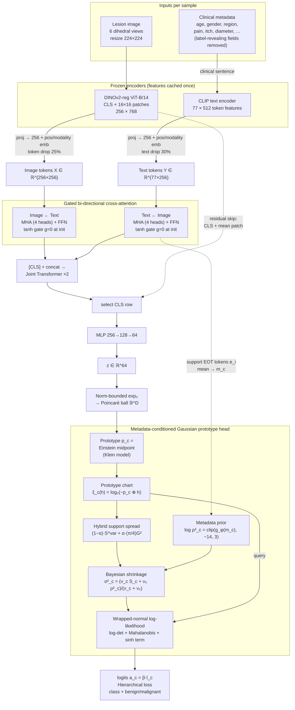

# GiMeHyp

**Gini-Informed and Metadata-Conditioned Variance Priors for Hyperbolic Few-Shot Skin Lesion Classification**

*Britika Khati¹\*, Rounak Saha²\*, Dmitrii Kaplun³, Ram Sarkar¹*
¹ Dept. of CSE, Jadavpur University, Kolkata · ² Dept. of ECE, Institute of Engineering and Management, Kolkata · ³ Intelligent Devices Institute, St. Petersburg Electrotechnical University "LETI"
\* Equal contribution · Submitted to ISBI

| Dataset | 3-shot Acc | 5-shot Acc | 10-shot Acc |
|---|---|---|---|
| PAD-UFES-20 (smartphone, 6 classes) | 74.51 % | **75.17 %** | 76.12 % |
| HAM10000 (dermoscopy, 7 classes) | 75.31 % | **78.62 %** | 78.83 % |

---

## Table of contents
1. [TL;DR](#tldr)
2. [Motivation](#motivation)
3. [Key contributions](#key-contributions)
4. [Architecture](#architecture)
5. [Methodology](#methodology)
6. [Training objective](#training-objective)
7. [Datasets and implementation](#datasets-and-implementation)
8. [Results and ablation](#results-and-ablation)
9. [Why GMD handles outliers better than variance alone (pseudo-data study)](#why-gmd-handles-outliers-better-than-variance-alone)
10. [Limitations](#limitations)
11. [Repository layout](#repository-layout)
12. [Citation](#citation)
13. [References](#references)

---

## TL;DR

With only 3–10 labelled images per class, a few-shot classifier can find **where** a class is (its prototype) but has a hard time telling **how widely it spreads**. GiMeHyp estimates that spread from two sources:

1. **A prior from the patients' clinical metadata.** The age, sex, body region, itch, pain, diameter and so on of the support patients predict a per-class, per-dimension variance prior.
2. **A Gini-informed spread from the support images.** This blends the usual empirical variance with a Gaussian-calibrated squared **Gini Mean Difference (GMD)**, which is less sensitive to a single odd support image.

The two are fused by **Bayesian shrinkage**, and queries are scored by a **diagonal wrapped-normal log-density on the Poincaré ball**. Every quantity is computed in the prototype's own hyperbolic chart. Features come from **frozen DINOv2 (image) and CLIP (text) encoders** fused by gated cross-attention.

---

## Motivation

- **Rare lesions have few labels.** Smartphone clinical photos also vary widely in pose, lighting and scale.
- **Prototypical networks** [1] score a query by its distance to a class mean. This implicitly assumes every class is an isotropic Gaussian with the **same spread**.
- **Earlier class-specific variance methods all shrink towards a target that ignores the patient**:
  - Gaussian Prototypical Networks [3] predict per-example variances inside the encoder.
  - Simple CNAPS [4] shrinks class covariances towards a task covariance with a fixed weight λₖ = nₖ/(nₖ+1).
  - Empirical-Bayes "moderated" variances [5] shrink towards a prior controlled by prior degrees of freedom.
- **Metadata is known to help skin lesion classification** [6], but it has only been used as an input feature, not to control uncertainty.
- **Robust statistics:** the Gini Mean Difference, built from pairwise absolute differences, is a more efficient spread measure than the standard deviation for heavy-tailed data [7].
- **Hyperbolic geometry:** hyperbolic prototypes [8] and wrapped normal distributions [9] provide a geometric home for Gaussian class models.

To the authors' knowledge, no prior work (i) learns the prototype classifier's variance prior from the support patients' metadata, (ii) estimates few-shot support spread with pairwise absolute differences, or (iii) combines both into a hyperbolic wrapped-normal prototype score.

---

## Key contributions

| # | Contribution | What it does |
|---|---|---|
| 1 | **Metadata-conditioned variance prior** | An MLP maps the averaged CLIP embedding of the support patients' clinical text to a per-class, per-dimension log-variance prior. Metadata now controls *how widely a class spreads*, not only where its features lie. |
| 2 | **Gini-informed support spread** | A per-dimension spread estimator blends the empirical second moment with (π/4)·GMD², computed in prototype-relative coordinates. Its small-sample behaviour is exactly characterised; for K = 3 it reduces to a function of the range (see below). |
| 3 | **Single-chart variance-adaptive hyperbolic inference** | Prior and spread are fused by conjugate shrinkage, and the query is scored with a wrapped-normal log-density, all in the **same** prototype-adjacent chart of the Poincaré ball. The variance is estimated in exactly the coordinates where it is used. |

---

## Architecture


*Figure 1 from the paper: the proposed model.*

The same pipeline as a flow diagram:



### Component summary

| Block | Details |
|---|---|
| Image encoder | Frozen **DINOv2 ViT-B/14 with registers** [10, 11]. Keeps [CLS] plus 16×16 = 256 patch tokens (768-d); register tokens discarded. |
| Text encoder | Frozen **CLIP** text transformer [12]. Each metadata record becomes a short clinical sentence with fields in a fixed order; diagnosis, biopsy status, histology and BI-RADS are excluded. Output: 77 × 512 after the final layer norm. |
| Projection | Both streams projected to d = 256 with learned positional and modality embeddings. |
| Fusion | One **bi-directional gated cross-attention** block (4-head MHA + FFN 256→1024→256, pre-LayerNorm). Each update is gated by a learnable tanh scalar **initialised to 0**, so the block starts as the identity. |
| Joint encoder | Learnable [CLS] prepended, then a **2-layer transformer encoder**. A residual skip adds the DINOv2 descriptor ([CLS] + mean patch) back to the CLS token. |
| Embedding head | MLP → 64-d embedding **z**. |
| Augmentation / regularisation | 6 dihedral views of each image, 25 % token drop (image), 30 % text drop. |
| Prototype head | Poincaré embedding → Einstein-midpoint prototypes → prototype charts → metadata prior + Gini spread → shrinkage → wrapped-normal score. |

---

## Methodology

**Episode setup.** Each sample is an image *I*, a metadata record *m* and a label *y ∈ {1,…,N}*. Each class *c* belongs to a superclass *g(c) ∈ {benign, malignant}*. An episode has a support set 𝒮 with **K = 3, 5 or 10** shots per class and a query set 𝒬 with **M = 5** queries per class. 𝒮_c denotes the supports of class *c*, with n_c = |𝒮_c|.

### 1. Hyperbolic embedding and prototype charts

The embedding is mapped into the Poincaré ball with a **norm-bounded exponential map**, which keeps points away from the unstable boundary:

$$
\mathbf h=\exp_{\mathbf 0}\big(b(\mathbf z)\big),\qquad
b(\mathbf z)=r\tanh\!\big(\lVert\mathbf z\rVert/r\big)\frac{\mathbf z}{\lVert\mathbf z\rVert},\qquad r=2
$$

so that ‖h‖ ≤ tanh 2.

- **Prototype:** p_c is the **Einstein midpoint** of {hᵢ}, i ∈ 𝒮_c, computed in the Klein model (Klein map → Lorentz factors → weighted mean → back to the ball).
- **Prototype chart:** every point is expressed relative to its prototype:

$$
\boldsymbol\xi_c(\mathbf h)=\log_{\mathbf 0}\!\big(-\mathbf p_c\oplus\mathbf h\big)\in\mathbb R^D,\qquad 2\lVert\boldsymbol\xi_c(\mathbf h)\rVert=d_{\mathbb B}(\mathbf p_c,\mathbf h)
$$

where ⊕ is Möbius addition. In the Euclidean ablation, h = z, p_c is the support mean and ξ_c(h) = h − p_c.

### 2. Metadata-conditioned variance prior (Contribution 1)

Let **eᵢ ∈ ℝ²⁵⁶** be the projected CLIP end-of-text token of support *i* (or a learned null token when metadata are missing), and let **m_c** be their mean over the class supports. A two-layer MLP g_φ predicts a per-dimension prior variance:

$$
\log\boldsymbol\rho_c^2=\operatorname{clip}\big(g_\phi(\mathbf m_c),\,-14,\,3\big)\in\mathbb R^D
$$

- The last layer is **zero-initialised**, with its bias set to the log of the mean spread of the untrained embeddings over 20 episodes. Training therefore starts from a sensible global prior.
- Only **support** metadata feed the prior. Query metadata act through the embedding.
- In effect the prior says, for each episode, *how widely patients similar to these supports scatter around their prototype*.

### 3. Gini-informed support spread (Contribution 2)

With ξ_id the d-th coordinate of ξ_c(hᵢ) and ν_c = max(n_c − 1, 1):

$$
S^{\text{var}}_{cd}=\frac1{\nu_c}\sum_{i\in\mathcal S_c}\xi_{id}^2,\qquad
G_{cd}=\binom{n_c}{2}^{-1}\sum_{i<k}\lvert\xi_{id}-\xi_{kd}\rvert
$$

For Gaussian data E[G] = 2σ/√π, so **(π/4)G² is variance-equivalent**, and the support spread is

$$
S_{cd}=(1-\alpha)\,S^{\text{var}}_{cd}+\alpha\,\tfrac{\pi}{4}G_{cd}^2,\qquad\alpha=0.5
$$

The blend is not unbiased, but its small-sample behaviour can be computed exactly.

> **Note on K = 3.** For three supports x₁ ≤ x₂ ≤ x₃, the three pairwise gaps sum to 2(x₃ − x₁), so **G = ⅔·range** and (π/4)G² = (π/9)·range². The 3-shot GMD term is therefore a pure range estimator; the demo script checks this numerically.

### 4. Variance-adaptive hyperbolic inference (Contribution 3)

Prior and data spread are fused by conjugate **shrinkage** [15], with a learned prior strength ν₀ = e^ω (initialised to 4):

$$
\sigma^2_{cd}=\max\left\{\frac{\nu_c S_{cd}+\nu_0\rho^2_{cd}}{\nu_c+\nu_0},\;10^{-6}\right\}
$$

A query h_q is scored in the **same chart**, with δ_cq = 2‖ξ_c(h_q)‖:

$$
l_c(\mathbf h_q)=-\frac12\sum_{d=1}^{D}\left[\log\sigma^2_{cd}+\frac{\xi_c(\mathbf h_q)_d^2}{\sigma^2_{cd}}\right]-(D-1)\log\frac{\sinh\delta_{cq}}{\delta_{cq}}
$$

- The first term is the **log-determinant**, the second the **Mahalanobis distance**, and the third the **hyperbolic volume correction**.
- h ↦ −p_c ⊕ h is an isometry whose differential coincides with parallel transport. Up to a class-independent constant (and ignoring the norm bound), the score is therefore the log-density of a **diagonal wrapped normal centred at p_c** [9, 16].
- Logits are a_c = β·l_c with a learned temperature β.
- The authors state that Eq. (6) is a plug-in estimate rather than a posterior predictive, and they make no calibration claim.

---

## Training objective

Classes are grouped into the **Benign / Malignant** superclasses [17]. The episodic loss adds a superclass term to the class term:

$$
\mathcal L=\mathrm{CE}(a,y)+\lambda\,\mathrm{CE}\big(a^{\text{sup}},y^{\text{sup}}\big),\qquad\lambda=0.5
$$

It is averaged over queries, with **label smoothing 0.1** [18].

| PAD-UFES-20 class | Superclass |
|---|---|
| ACK (actinic keratosis) | benign |
| BCC (basal cell carcinoma) | malignant |
| MEL (melanoma) | malignant |
| NEV (nevus) | benign |
| SCC (squamous cell carcinoma) | malignant |
| SEK (seborrheic keratosis) | benign |

---

## Datasets and implementation

| Dataset | Modality | Images | Classes | Metadata |
|---|---|---|---|---|
| **PAD-UFES-20** [17] | Smartphone clinical photos, variable resolution | 2,298 images from 1,373 patients | 6 | Up to 26 clinical fields; all biopsy-proven |
| **HAM10000** [19] | Dermoscopy, 600×450 px, two clinical sites | 10,015 | 7 | Age, sex, localisation; > 50 % histopathology-confirmed |

| Setting | Value |
|---|---|
| Framework | PyTorch 2.10, CUDA 12.8 |
| Hardware | 2 × NVIDIA Tesla T4 |
| Optimiser | AdamW, lr 2×10⁻⁴, weight decay 10⁻² |
| Loss | Hierarchical CE (λ = 0.5), label smoothing 0.1 |
| Episodes | N-way K-shot (K ∈ {3, 5, 10}), M = 5 queries/class, 50 episodes/epoch, 10 epochs |
| Embedding | D = 64, ball radius bound r = 2 |
| Spread blend | α = 0.5 |
| Prior strength | ν₀ = e^ω, initialised to 4 (learned) |
| Prior clamp | log ρ² ∈ [−14, 3] |

---

## Results and ablation

Accuracy and macro F1 (%), mean ± std over episodes. Each row adds one component to the row above.

### PAD-UFES-20

| Model variant | 3-shot Acc | 3-shot F1 | 5-shot Acc | 5-shot F1 | 10-shot Acc | 10-shot F1 |
|---|---|---|---|---|---|---|
| Baseline CLIP-DINOv2 | 44.37±2.54 | 44.19±2.77 | 46.91±2.81 | 46.77±1.71 | 54.56±2.46 | 54.47±2.39 |
| + Cross-attention Transformer | 56.28±2.48 | 55.48±2.62 | 57.15±2.78 | 56.42±2.88 | 58.69±2.46 | 58.17±2.42 |
| + Hyperbolic Poincaré & Gaussian | 62.58±2.61 | 62.45±2.42 | 64.10±3.12 | 63.94±2.98 | 65.65±2.42 | 65.59±2.37 |
| + Metadata prior | 70.67±2.35 | 70.36±2.45 | 72.78±2.43 | 72.56±2.53 | 73.21±2.22 | 73.08±2.09 |
| **+ Gini spread (full model)** | **74.51±2.26** | **74.62±2.44** | **75.17±2.21** | **75.23±2.23** | **76.12±2.14** | **76.15±2.18** |

### HAM10000

| Model variant | 3-shot Acc | 3-shot F1 | 5-shot Acc | 5-shot F1 | 10-shot Acc | 10-shot F1 |
|---|---|---|---|---|---|---|
| Baseline CLIP-DINOv2 | 31.49±2.72 | 31.45±1.65 | 35.54±2.21 | 34.67±1.98 | 39.37±2.69 | 37.45±2.35 |
| + Cross-attention Transformer | 52.15±2.47 | 51.96±2.52 | 54.36±2.29 | 54.29±2.21 | 55.76±2.57 | 55.26±2.47 |
| + Hyperbolic Poincaré & Gaussian | 61.48±2.38 | 61.17±2.81 | 63.25±2.35 | 63.21±2.43 | 65.32±2.47 | 65.23±2.41 |
| + Metadata prior | 72.68±2.29 | 72.48±2.37 | 75.18±2.24 | 75.15±2.37 | 75.82±2.51 | 75.63±2.32 |
| **+ Gini spread (full model)** | **75.31±2.16** | **75.54±2.24** | **78.62±1.21** | **78.58±2.26** | **78.83±2.19** | **78.85±2.16** |

### What each component adds (5-shot accuracy, percentage points)

| Step | PAD-UFES-20 | HAM10000 |
|---|---|---|
| Cross-attention fusion | +10.24 | +18.82 |
| Hyperbolic + Gaussian head | +6.95 | +8.89 |
| Metadata-conditioned prior | +8.68 | +11.93 |
| Gini-informed spread | +2.39 | +3.44 |
| **Total over baseline** | **+28.26** | **+43.08** |

**Takeaways**
- Every component helps on both datasets and at every shot count.
- The **metadata prior** is the largest single gain among the three variance-related contributions (+8.7 / +11.9 pp at 5-shot).
- The **Gini spread** adds a further +2–4 pp on top of an already strong model. Its gain is largest at **3-shot on PAD-UFES-20 (+3.84 pp)**, where one bad support has the most influence.
- Gains shrink from 5 to 10 shots: more supports make plain variance estimates more reliable.

---

## Why GMD handles outliers better than variance alone

> Everything in this section uses **synthetic pseudo-data**, not the skin-lesion datasets. Reproduce it with `python gmd_vs_variance_demo.py` (NumPy and Matplotlib only, about 1 minute). All numbers are in `assets/results.txt`.

### The intuition

Both estimators measure spread, but they weight a far-away point differently.

| | Empirical variance S^var | Gini Mean Difference G |
|---|---|---|
| Built from | **squared** distances to the prototype | **absolute** pairwise differences |
| A point at distance *a* contributes | ∝ *a²* | ∝ *a* |
| Population influence function | quadratic in *x* | linear in *x* |
| Efficiency on clean Gaussian data | 100 % (optimal) | ≈ 98 % (almost no loss) [7] |

Because the variance squares each deviation, **one atypical support** dominates it: a mislabelled lesion, a blurred phone photo or an unusual presentation. In the classifier, an inflated σ²_c makes that class's Gaussian too wide. It then claims queries from neighbouring classes and becomes over-tolerant.

### A closed-form look: one outlier among K supports

Put K − 1 supports near the centre and one outlier at distance *a*, with *a* large. In the Euclidean chart (prototype = mean):

| Estimator | Leading term in *a* |
|---|---|
| S^var (variance) | a² / K |
| (π/4)·G² (GMD) | π·a² / K² |
| Hybrid, α = 0.5 | (a² / 2K)·(1 + π/K) |

So **an outlier's leverage on the GMD term is about π/K times its leverage on the variance**:

| K | π/K | Interpretation |
|---|---|---|
| 3 | 1.05 | No protection; GMD behaves like a range estimator |
| 5 | 0.63 | GMD inflates about 37 % less |
| 10 | 0.31 | GMD inflates about 69 % less |

### Experiment 1: 1D outlier sweep

K − 1 clean supports come from N(0, 1) and one support is placed at distance *a*. The figure shows the median estimated variance over 3,000 trials.


| K | Outlier at | Variance | GMD (π/4)G² | Hybrid (paper) | GMD / Var |
|---|---|---|---|---|---|
| 3 | 10σ | 33.8 | 38.7 | 36.2 | 1.15 |
| 5 | 10σ | 20.8 | 17.0 | 19.0 | 0.82 |
| 10 | 8σ | 7.27 | 4.85 | 6.04 | 0.67 |
| 10 | 10σ | 10.9 | 6.6 | 8.8 | **0.61** |

The true variance is 1. With 10 supports, an outlier at 10σ inflates the variance about **11×** but the GMD estimate only about **6.6×**. The paper's hybrid sits in between.

### Experiment 2: 2D few-shot classification with contaminated supports

This experiment uses three 2D Gaussian classes with different shapes. Each support is independently replaced by an outlier 6σ away with probability *p*; queries are clean. Classification uses the Euclidean version of Eq. (7): diagonal Gaussian, log-det + Mahalanobis. Each point is 4,000 episodes × 15 queries.


*Left:* a single outlier support (★) drags the prototype and inflates the fitted class ellipse. The variance-only ellipse (red) is the widest and covers the supports of both neighbouring classes. GMD (blue) is the tightest, and the hybrid (green) sits between them.
*Right:* query accuracy as contamination grows.

| K | Outlier prob. | Variance | GMD | Hybrid |
|---|---|---|---|---|
| 5 | 0 % | 92.13 | 92.24 | 92.17 |
| 5 | 10 % | 89.14 | **89.45** | 89.34 |
| 5 | 20 % | 86.79 | **87.13** | 86.97 |
| 10 | 0 % | 95.22 | 95.22 | 95.22 |
| 10 | 10 % | 93.52 | **93.79** | 93.68 |
| 10 | 20 % | 91.64 | **92.03** | 91.85 |

### Experiment 3: scale recovery under heavy tails (1D Monte Carlo)

This experiment measures the median |log(σ̂²/σ²)| over 20,000 draws (lower is better).


| Distribution | K | Variance | GMD | Hybrid |
|---|---|---|---|---|
| Gaussian | 5 | 0.499 | 0.504 | **0.498** |
| Gaussian | 10 | 0.329 | **0.327** | **0.327** |
| Student-t (ν = 3) | 5 | 0.692 | **0.682** | 0.685 |
| Student-t (ν = 3) | 10 | 0.519 | **0.494** | 0.507 |
| 10 % contaminated (5σ) | 10 | 0.679 | **0.659** | 0.669 |

### What the pseudo-data shows (and what it doesn't)

1. **GMD reduces outlier-driven variance inflation, and the reduction grows with K** (about π/K). At 10-shot it removes roughly 40 % of the inflation caused by a single 10σ outlier.
2. **It costs almost nothing on clean data.** On Gaussian supports, all three estimators have essentially the same error. This is why GMD is a safe default to blend in.
3. **The hybrid is a deliberate compromise.** It keeps the variance's familiar behaviour and bias while gaining part of GMD's protection. In the paper, a learned metadata prior and shrinkage (Eq. 6) further damp what remains.
4. **Limitations.** GMD is *not* a high-breakdown estimator: one point far enough away still inflates it without limit. At **K = 3** it offers no protection (G = ⅔·range), and in our 1D sweep it was slightly worse than variance there. The toy accuracy gains are modest (≈ 0.3–0.4 pp). In the real model the Gini term's larger gain probably comes from its interaction with the learned embedding and prior, which this toy does not capture.

---

## Limitations

- The paper evaluates only within each dataset. Cross-dataset and cross-domain generalisation is listed as future work.
- The shrinkage in Eq. (6) is a plug-in estimate, not a posterior predictive, and the model is **not claimed to be calibrated**.
- Both backbones are frozen. Adapting them might give further gains, at higher compute cost.

---

## Repository layout

```
.
├── README.md
├── gmd_vs_variance_demo.py        # pseudo-data study in this README
└── assets/
    ├── paper_fig1_architecture.png
    ├── fig1_outlier_sweep_1d.png
    ├── fig2_heavy_tail_mc.png
    ├── fig3_2d_ellipses.png
    └── results.txt
```

> Official code: *link to be added (the paper's GitHub link is still blank).*

---

## Citation

```bibtex
@inproceedings{khati2026gimehyp,
  title     = {Gini Informed and Metadata-Conditioned Variance Priors for
               Hyperbolic Few-Shot Skin Lesion Classification},
  author    = {Khati, Britika and Saha, Rounak and Kaplun, Dmitrii and Sarkar, Ram},
  booktitle = {IEEE International Symposium on Biomedical Imaging (ISBI)},
  year      = {2026},
  note      = {Under review}
}
```

---

## References

1. Snell, Swersky, Zemel. *Prototypical networks for few-shot learning.* NeurIPS 2017.
2. Prabhu et al. *Few-shot learning for dermatological disease diagnosis.* MLHC 2019.
3. Fort. *Gaussian prototypical networks for few-shot learning on Omniglot.* arXiv:1708.02735, 2017.
4. Bateni et al. *Improved few-shot visual classification.* CVPR 2020.
5. Smyth. *Linear models and empirical Bayes methods for assessing differential expression in microarray experiments.* SAGMB 2004.
6. Pacheco, Krohling. *An attention-based mechanism to combine images and metadata in deep learning models applied to skin cancer classification.* IEEE JBHI 2021.
7. Yitzhaki. *Gini's mean difference: a superior measure of variability for non-normal distributions.* Metron 2003.
8. Khrulkov et al. *Hyperbolic image embeddings.* CVPR 2020.
9. Nagano et al. *A wrapped normal distribution on hyperbolic space for gradient-based learning.* ICML 2019.
10. Oquab et al. *DINOv2: Learning robust visual features without supervision.* TMLR 2024.
11. Darcet et al. *Vision transformers need registers.* ICLR 2024.
12. Radford et al. *Learning transferable visual models from natural language supervision.* ICML 2021.
13. Ungar. *A Gyrovector Space Approach to Hyperbolic Geometry.* Morgan & Claypool, 2008.
14. Ganea, Bécigneul, Hofmann. *Hyperbolic neural networks.* NeurIPS 2018.
15. Gelman et al. *Bayesian Data Analysis*, 3rd ed. CRC Press, 2013.
16. Mathieu et al. *Continuous hierarchical representations with Poincaré variational auto-encoders.* NeurIPS 2019.
17. Pacheco et al. *PAD-UFES-20: a skin lesion dataset composed of patient data and clinical images collected from smartphones.* Data in Brief 2020.
18. Szegedy et al. *Rethinking the inception architecture for computer vision.* CVPR 2016.
19. Tschandl, Rosendahl, Kittler. *The HAM10000 dataset.* Scientific Data 2018.
