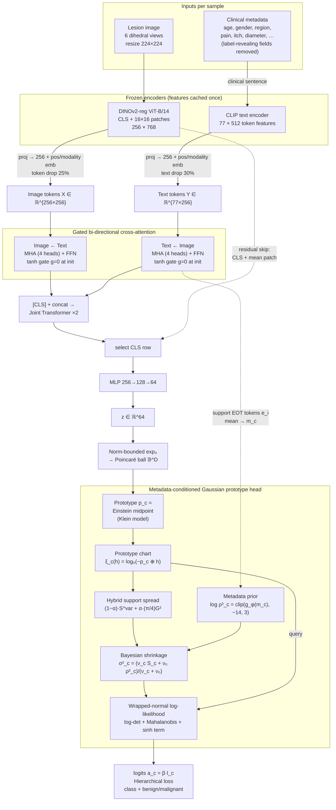

# GiMeHyp

**Gini-Informed and Metadata-Conditioned Variance Priors for Hyperbolic Few-Shot Skin Lesion Classification**

*Britika Khati¹\*, Rounak Saha²\*, Dmitrii Kaplun³, Ram Sarkar¹*
¹ Dept. of CSE, Jadavpur University, Kolkata · ² Dept. of ECE, Institute of Engineering and Management, Kolkata · ³ Intelligent Devices Institute, St. Petersburg Electrotechnical University "LETI"
\* Equal contribution · Submitted to ISBI

| Dataset | 3-shot Acc | 5-shot Acc | 10-shot Acc |
|---|---|---|---|
| PAD-UFES-20 (smartphone, 6 classes) | 74.51 % | **75.17 %** | 76.12 % |
| HAM10000 (dermoscopy, 7 classes) | 75.31 % | **78.62 %** | 78.83 % |

---

## Table of contents
1. [TL;DR](#tldr)
2. [Motivation](#motivation)
3. [Key contributions](#key-contributions)
4. [Architecture](#architecture)
5. [Methodology](#methodology)
6. [Training objective](#training-objective)
7. [Datasets and implementation](#datasets-and-implementation)
8. [Results and ablation](#results-and-ablation)
9. [Why GMD handles outliers better than variance alone (pseudo-data study)](#why-gmd-handles-outliers-better-than-variance-alone)
10. [Limitations](#limitations)
11. [Repository layout](#repository-layout)
12. [Citation](#citation)
13. [References](#references)

---

## TL;DR

With only 3–10 labelled images per class, a few-shot classifier can find **where** a class is (its prototype) but has a hard time telling **how widely it spreads**. GiMeHyp estimates that spread from two sources:

1. **A prior from the patients' clinical metadata.** The age, sex, body region, itch, pain, diameter and so on of the support patients predict a per-class, per-dimension variance prior.
2. **A Gini-informed spread from the support images.** This blends the usual empirical variance with a Gaussian-calibrated squared **Gini Mean Difference (GMD)**, which is less sensitive to a single odd support image.

The two are fused by **Bayesian shrinkage**, and queries are scored by a **diagonal wrapped-normal log-density on the Poincaré ball**. Every quantity is computed in the prototype's own hyperbolic chart. Features come from **frozen DINOv2 (image) and CLIP (text) encoders** fused by gated cross-attention.

---

## Motivation

- **Rare lesions have few labels.** Smartphone clinical photos also vary widely in pose, lighting and scale.
- **Prototypical networks** [1] score a query by its distance to a class mean. This implicitly assumes every class is an isotropic Gaussian with the **same spread**.
- **Earlier class-specific variance methods all shrink towards a target that ignores the patient**:
  - Gaussian Prototypical Networks [3] predict per-example variances inside the encoder.
  - Simple CNAPS [4] shrinks class covariances towards a task covariance with a fixed weight λₖ = nₖ/(nₖ+1).
  - Empirical-Bayes "moderated" variances [5] shrink towards a prior controlled by prior degrees of freedom.
- **Metadata is known to help skin lesion classification** [6], but it has only been used as an input feature, not to control uncertainty.
- **Robust statistics:** the Gini Mean Difference, built from pairwise absolute differences, is a more efficient spread measure than the standard deviation for heavy-tailed data [7].
- **Hyperbolic geometry:** hyperbolic prototypes [8] and wrapped normal distributions [9] provide a geometric home for Gaussian class models.

To the authors' knowledge, no prior work (i) learns the prototype classifier's variance prior from the support patients' metadata, (ii) estimates few-shot support spread with pairwise absolute differences, or (iii) combines both into a hyperbolic wrapped-normal prototype score.

---

## Key contributions

| # | Contribution | What it does |
|---|---|---|
| 1 | **Metadata-conditioned variance prior** | An MLP maps the averaged CLIP embedding of the support patients' clinical text to a per-class, per-dimension log-variance prior. Metadata now controls *how widely a class spreads*, not only where its features lie. |
| 2 | **Gini-informed support spread** | A per-dimension spread estimator blends the empirical second moment with (π/4)·GMD², computed in prototype-relative coordinates. Its small-sample behaviour is exactly characterised; for K = 3 it reduces to a function of the range (see below). |
| 3 | **Single-chart variance-adaptive hyperbolic inference** | Prior and spread are fused by conjugate shrinkage, and the query is scored with a wrapped-normal log-density, all in the **same** prototype-adjacent chart of the Poincaré ball. The variance is estimated in exactly the coordinates where it is used. |

---

## Architecture

<!-- ============================================================
     ADD YOUR OWN ARCHITECTURE DIAGRAM HERE
     1. Put your image in the assets/ folder, e.g. assets/architecture.png
     2. Change the file name in the line below if yours is different
     ============================================================ -->

  

<i>Figure 1: Architecture of the proposed model.</i>

<!-- ============================================================ -->

The same pipeline as a flow diagram:

### Component summary

| Block | Details |
|---|---|
| Image encoder | Frozen **DINOv2 ViT-B/14 with registers** [10, 11]. Keeps [CLS] plus 16×16 = 256 patch tokens (768-d); register tokens discarded. |
| Text encoder | Frozen **CLIP** text transformer [12]. Each metadata record becomes a short clinical sentence with fields in a fixed order; diagnosis, biopsy status, histology and BI-RADS are excluded. Output: 77 × 512 after the final layer norm. |
| Projection | Both streams projected to d = 256 with learned positional and modality embeddings. |
| Fusion | One **bi-directional gated cross-attention** block (4-head MHA + FFN 256→1024→256, pre-LayerNorm). Each update is gated by a learnable tanh scalar **initialised to 0**, so the block starts as the identity. |
| Joint encoder | Learnable [CLS] prepended, then a **2-layer transformer encoder**. A residual skip adds the DINOv2 descriptor ([CLS] + mean patch) back to the CLS token. |
| Embedding head | MLP → 64-d embedding **z**. |
| Augmentation / regularisation | 6 dihedral views of each image, 25 % token drop (image), 30 % text drop. |
| Prototype head | Poincaré embedding → Einstein-midpoint prototypes → prototype charts → metadata prior + Gini spread → shrinkage → wrapped-normal score. |

---

## Methodology

**Episode setup.** Each sample is an image *I*, a metadata record *m* and a label *y ∈ {1,…,N}*. Each class *c* belongs to a superclass *g(c) ∈ {benign, malignant}*. An episode has a support set 𝒮 with **K = 3, 5 or 10** shots per class and a query set 𝒬 with **M = 5** queries per class. 𝒮_c denotes the supports of class *c*, with n_c = |𝒮_c|.

### 1. Hyperbolic embedding and prototype charts

The embedding is mapped into the Poincaré ball with a
